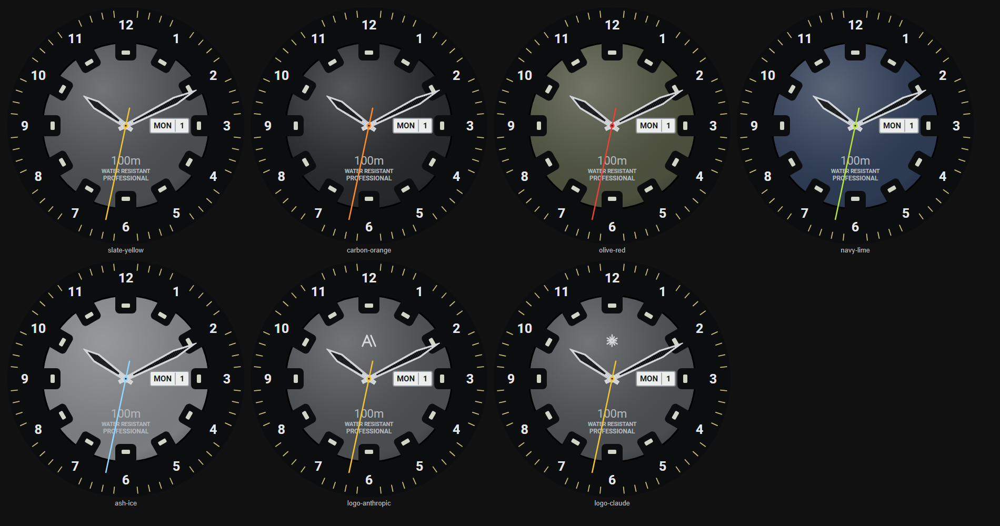

# Rampart — watch face for Galaxy Watch Ultra 2



An analog diver-style face built in Google's **Watch Face Format** (v2).

- A heavy black chapter ring with blocky teeth at every hour, each carrying a lume bar, and the hour numerals on the ring.
- Skeleton sword hands, a ticking seconds hand and a day-date window at 3.
- Settings in the watch's customise screen:
  - **Dial**: Slate, Carbon, Olive, Navy, Ash.
  - **Seconds**: Yellow, Orange, Red, Lime, Ice, White.
  - **Logo** below 12: none, Anthropic or Claude.
- Always-on display mode hides the dial colour and seconds hand and dims the rest.

## Get the APK

Every push that touches `Rampart/` runs the **Build watch face** GitHub Action. Download the `rampart-watch-face` artifact.
Install it the same way as Tidal (see `WatchFace/README.md`).

## Editing

Don't hand-edit `app/src/main/res/raw/watchface.xml`. Change `tools/generate.py` and run:

```sh
python3 tools/generate.py                     # rewrites watchface.xml, strings.xml and preview/*.svg
python3 tools/validate.py <path-to>/watchface/third_party/wff/specification/documents/2/watchface.xsd
```
