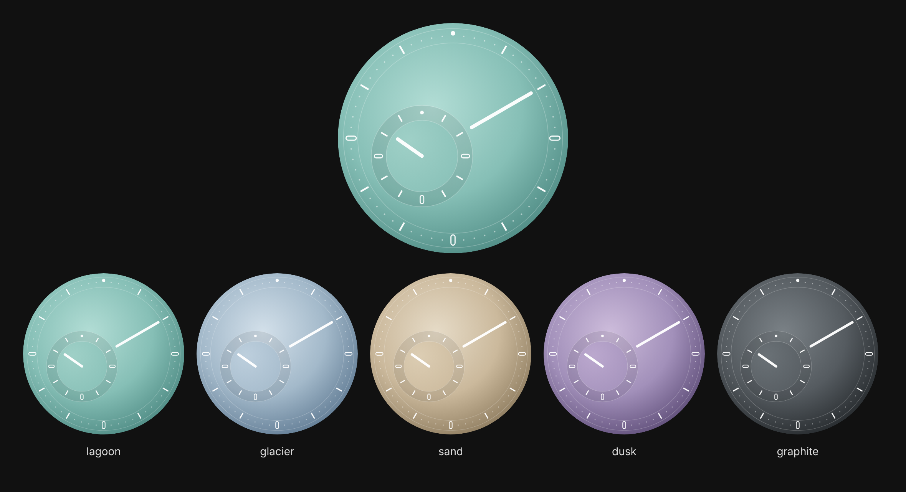

# Tidal — watch face for Galaxy Watch Ultra 2



An analog face built in Google's **Watch Face Format** (v2), the format Samsung Galaxy watches use on Wear OS 5 and later.

- The centre disc turns once an hour and carries the minute hand.
- The hour sub-dial sits opposite the minute hand and orbits with it. It counter-rotates so its markers stay upright, and its own hand shows the hour.
- There are five dial colours to choose from in the watch's customise screen: Lagoon, Glacier, Sand, Dusk and Graphite.
- Always-on display mode drops the dial colour to black and dims the markers to save battery.

## Get the APK

Every push that touches `WatchFace/` runs the **Build watch face** GitHub Action.
Open the run under the repository's *Actions* tab and download the `tidal-watch-face` artifact. It is a zip that holds `app-release.apk`.

## Install on the watch

1. **On the watch, turn on developer options.** Go to Settings → About watch → Software information and tap *Software version* 5 times.
2. **Turn on debugging.** Go to Settings → Developer options and turn on *ADB debugging* and *Wireless debugging*. Your watch and computer need to be on the same Wi-Fi.
3. **Pair and connect from your computer** (this needs [platform-tools](https://developer.android.com/tools/releases/platform-tools)):
   ```sh
   adb pair <watch-ip>:<pairing-port>   # enter the code the watch shows under "Pair new device"
   adb connect <watch-ip>:<port>
   adb install app-release.apk
   ```
   No computer? An Android phone app such as *Bugjaeger* can do the same pairing and install.
4. **Choose the face.** Long-press the current watch face, swipe to the end, tap **+**, and pick **Tidal**. You can also use the Galaxy Wearable app → Watch faces.
5. **Change the colour.** Long-press the face → Customise.

## Editing

Don't hand-edit `app/src/main/res/raw/watchface.xml`. It is generated, so change `tools/generate.py` and run:

```sh
python3 tools/generate.py                     # rewrites watchface.xml, strings.xml and preview/*.svg
python3 tools/validate.py <path-to>/watchface/third_party/wff/specification/documents/2/watchface.xsd
```

Geometry constants and colour themes are at the top of the generator.
You can also open this folder in Android Studio and run it on the Wear OS emulator.
